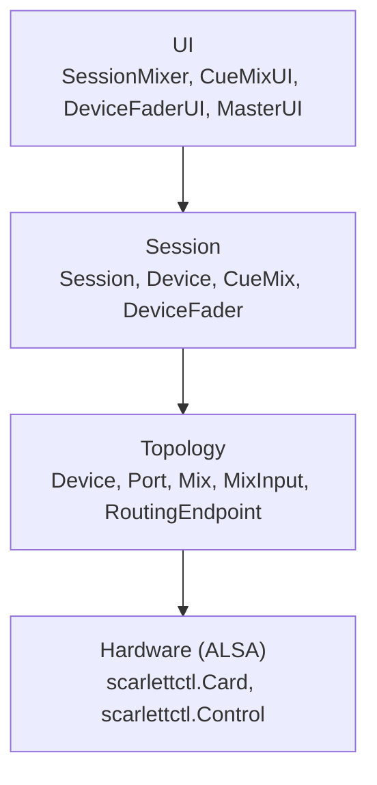

# The mixer

sessionmixer is four layers, each reaching only the one below it:

The topology layer models what the interface exposes: mono ports (`analogue-in-1`, `pcm-playback-1`, …), the mix buses (A–L) and their inputs, routing endpoints with a source enum, and the level meters. A `DeviceProfile` describes one device at one firmware version, auto-selected by card name and firmware; `docs/current/*-layout.md` are the control layouts the profiles were written from. `DeviceState` tracks runtime levels and gang state.

The session layer is what the configuration names. A device is a named source or destination over one port (mono) or two (stereo). A cue mix is a stereo allocation of a mix pair (`A+B`, `C+D`, …) routed to hardware outputs, with one fader per device. Configuration lives at `~/.config/sessionmixer/session.yaml`; the README documents the fields, and `etc/example-config.yaml` is a working example.

## Data flow

A fader drag goes down through `DeviceFader.HandleUIChange`, which checks the new value against the cached one, then writes every ganged volume control to ALSA. An external change comes up as an ALSA event into `SessionEventMonitor`, which calls `DeviceFader.HandleHWChange`; the same equality check returns early when the event is the echo of the ui's own write, breaking the loop, and otherwise atomically updates the cached value the next `Draw()` reads. `BIDIRECTIONAL_UPDATE_STRATEGY.md` is the full account of why this works without debouncing or locks.

## Stereo ganging

For a stereo cue mix with a stereo device, one fader drives Mix A's input for the device's left port and Mix B's input for its right port. For a mono device in a stereo cue mix, the same input number in both mixes is ganged together.

## Mute

Mute is routing. `CueMix.SetMuted(true)` saves each output's current source, routes every output to `Off`, and updates the endpoint's cached source index. `SetMuted(false)` restores the saved sources and updates the cache again. The cache update is load-bearing: without it the next mute or unmute cycle acts on a stale source.

## Startup

`CueMix.InitializeFromHardware()` reads the current routing and compares it with the routing the cue mix expects (its mixes on its outputs). A match starts the mix active; a mismatch starts it muted, with the expected routing saved for the first unmute. Startup never writes routing.

## Metering

Level meters use a 96 dB range with a green-to-yellow-to-red HSV gradient, optionally smoothed through a ring buffer (`level_smoothing` samples; 0 disables). The VU meters run in highres mode with 1px segments and 1px gaps.

Clicking a channel title (a device name or an output label) toggles a VU waterfall beside the meter: level history scrolling upward, newest at the bottom. It samples on a 16 ms interval so scroll speed is independent of frame rate, draws 1px rows with alternating opacity for a scanline effect, keeps 300 samples per device fader (303 for the master), and widens the column while shown. Which waterfalls are open is saved with the window state in `~/.config/sessionmixer/ui.json`.

## Outputs by device name

A cue mix's `outputs` may list raw port ids (`analogue-out-1`) or device names (`S/PDIF`), which expand to the device's ports. A device name wins a naming conflict.
